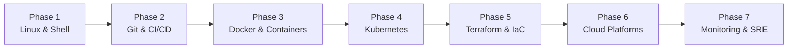

<div align="center">

# 🛠️ DevOps Mastery Tutorial

### Structured 9-week DevOps roadmap, hands-on tutorials, and interactive progress-tracking application

[](https://github.com/akazad13/devops-mastery-tutorial/actions)
[](https://react.dev/)
[](https://vitejs.dev/)
[](https://www.docker.com/)
[](https://kubernetes.io/)
[](LICENSE)

[Overview](#-overview) •
[Curriculum Phases](#-curriculum-phases) •
[Tech Stack](#-tech-stack) •
[Repository Layout](#-repository-layout) •
[Quick Start](#-quick-start) •
[License](#-license)

</div>

---

## 📌 Overview

**DevOps Mastery Tutorial** is a comprehensive, interactive learning web application guiding engineers through a structured 9-week DevOps and cloud engineering roadmap. Built with React and Vite, the platform bundles complete hands-on tutorials across Linux, Git, CI/CD pipelines, Docker containerization, Kubernetes orchestration, Infrastructure as Code (Terraform), and cloud monitoring.

### Key Highlights
- 🧭 **7 Comprehensive Phases**: Step-by-step curriculum with day-by-day learning sessions and practical lab exercises.
- 📊 **Local Progress Tracking**: Tracks session completion status persisted directly in browser `localStorage`.
- 📝 **In-App Lesson Viewer**: Native markdown lesson rendering with syntax-highlighted commands and configuration examples.
- 🧰 **Resources & Cheatsheets**: Interactive reference catalog of DevOps tools, setup scripts, and glossary.

---

## 🏛 Curriculum Phases



| Phase | Core Competencies | Topics Covered |
| :--- | :--- | :--- |
| **Phase 1: Linux & Shell** | CLI mastery & automation | Bash scripting, process management, permissions, networking basics |
| **Phase 2: Version Control & CI/CD** | Pipeline automation | Git workflows, GitHub Actions, automated testing, release strategies |
| **Phase 3: Containerization** | Application packaging | Dockerfiles, multi-stage builds, Docker Compose, container security |
| **Phase 4: Orchestration** | Cluster management | Kubernetes architecture, Pods, Deployments, Services, Ingress, Helm |
| **Phase 5: Infrastructure as Code** | Reproducible infrastructure | Terraform syntax, state management, modules, drift detection |
| **Phase 6: Cloud Deployments** | Cloud architecture | Cloud architectures (AWS/Azure), IAM, VPCs, managed databases |
| **Phase 7: Observability & SRE** | Production operations | Prometheus, Grafana, ELK stack, alerting, incident runbooks |

---

## 🛠 Tech Stack

| Domain | Technologies |
| :--- | :--- |
| **Frontend Framework** | React 18, React Router |
| **Build Tool** | Vite 5 |
| **Content & Rendering** | `react-markdown`, `remark-gfm`, `react-syntax-highlighter` |
| **State Persistence** | Browser `localStorage` (theme and progress tracking) |

---

## 📂 Repository Layout

```text
├── src/
│   ├── App.jsx            # Application shell, routing, top navigation, sidebar
│   ├── content.js         # Bundled lesson markdown content map
│   ├── curriculum.js      # Curriculum phases, metadata, and day checklists
│   ├── hooks.js           # Theme and progress persistence hooks
│   ├── components/        # Markdown wrapper, visualizers, diagrams
│   ├── pages/             # Home, PhasePage, ProgressPage, ResourcesPage
│   └── styles.css         # Responsive styling
├── index.html             # HTML entry point
└── package.json           # Dependencies and scripts
```

---

## 🚀 Quick Start

### Prerequisites
- Node.js 18+
- npm 9+

### 1. Clone & Install
```bash
git clone https://github.com/akazad13/devops-mastery-tutorial.git
cd devops-mastery-tutorial
npm install
```

### 2. Start Development Server
```bash
npm run dev
```
Open `http://localhost:5173` in your browser.

### 3. Build for Production
```bash
npm run build
npm run preview
```

---

## 🤖 AI-Driven Development & Contributing

Autonomous coding agents (Antigravity, Cursor, Claude Code, GitHub Copilot) operating in this repository must consult [AGENTS.md](AGENTS.md) for curriculum content invariants (`src/curriculum.js`), markdown rendering rules, and build validation commands.

---

## 👤 Author

**Md. Abul Kalam**
- GitHub: [@akazad13](https://github.com/akazad13)
- LinkedIn: [Md. Abul Kalam](https://linkedin.com/in/akazad13)

---

## 📄 License

This project is licensed under the [MIT License](LICENSE).
